

# 🔴 sumankumarkhan.com

### *I build software that goes **live**.*

**My personal portfolio, designed like a live-production control room** — server-rendered on the edge, with a private studio that publishes posts to the site, LinkedIn and dev.to on a schedule, reports the site's own traffic, and keeps a private handbook library.

> 🔒 **Source code is private.** This repository is a project showcase only. © 2026 Suman Kumar Khan — all rights reserved. See [LICENSE](LICENSE).

---

## 📺 On air

<table>
<tr>
<td width="50%">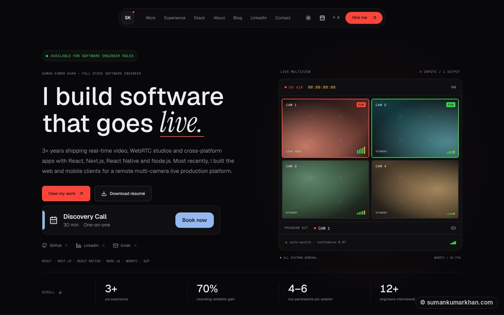</td>
<td width="50%">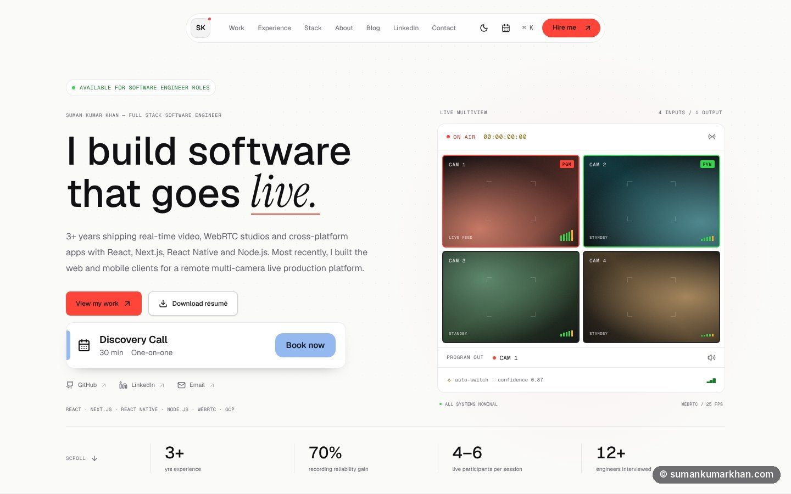</td>
</tr>
<tr>
<td align="center"><b>Dark theme</b> — the hero runs a simulated four-camera multiview with an auto-switch confidence readout</td>
<td align="center"><b>Light theme</b> — chosen before first paint, so there's never a wrong-theme flash</td>
</tr>
</table>

---

## ⚡ At a glance

<table>
<tr>
<td align="center" width="16%"><h3>10</h3>numbered home sections, from Impact to Contact</td>
<td align="center" width="16%"><h3>5</h3>engineering case studies with their own pages</td>
<td align="center" width="16%"><h3>3</h3>publishing targets: site, LinkedIn and dev.to</td>
<td align="center" width="16%"><h3>⌘K</h3>command palette for every page and action</td>
<td align="center" width="16%"><h3>0</h3>cookies — privacy-friendly analytics, no banner</td>
<td align="center" width="16%"><h3>390+</h3>automated tests</td>
</tr>
</table>

---

## 🎛️ The design idea

My work is real-time video, so the whole site is styled like a **broadcast control room** rather than a template portfolio:

- 🎥 **Live multiview hero** — four camera tiles with PGM / PVW tally lights, a running timecode and an *auto-switch confidence* readout, echoing the AI camera switching I built for Prisium
- 🎚️ **Stack as a mixing console** — skills are grouped into seven channels (`CH 01`–`CH 07`) with faders, and hovering a technology highlights the projects that used it
- 📡 **"No Signal" 404 page** and an **"On Air"** easter egg — type `live` anywhere on the page
- ✍️ **Type pairing** — Geist and Geist Mono for the interface, Instrument Serif italics for the one emphasised word in each heading

---

## 🗺️ Tour

### Experience — a timeline of every role
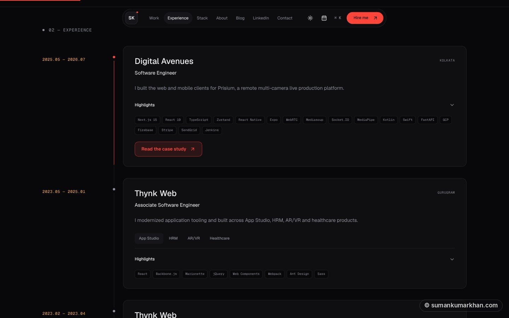

Each role has expandable highlights, the exact stack used, and a link to its case study. Thynk Web's four products sit behind tabs instead of one long list.

### Production work — filterable project cards
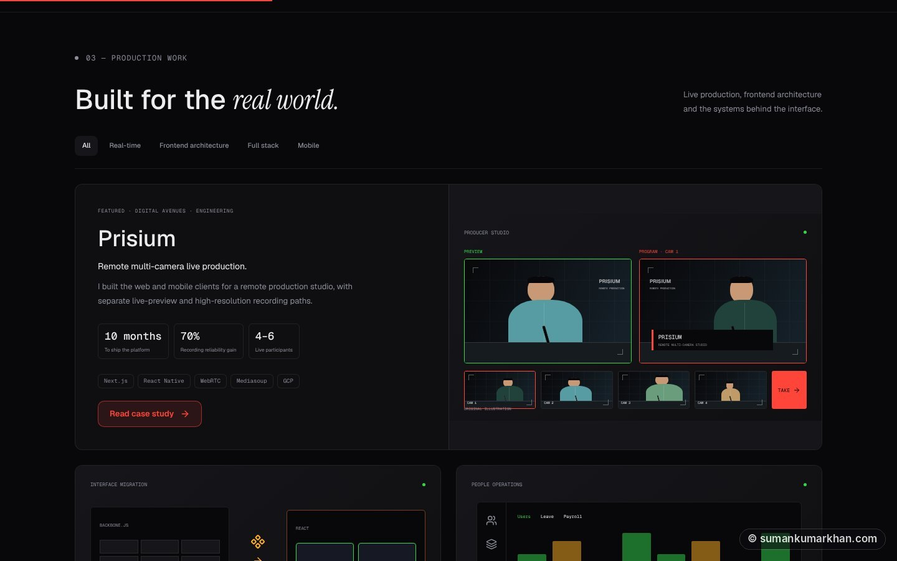

Filter by **Real-time, Frontend architecture, Full stack or Mobile**. Every card has its own illustrated visual — clearly labelled as illustrations, never fake product screenshots — plus key metrics and a link to the full case study.

### Stack — seven channels
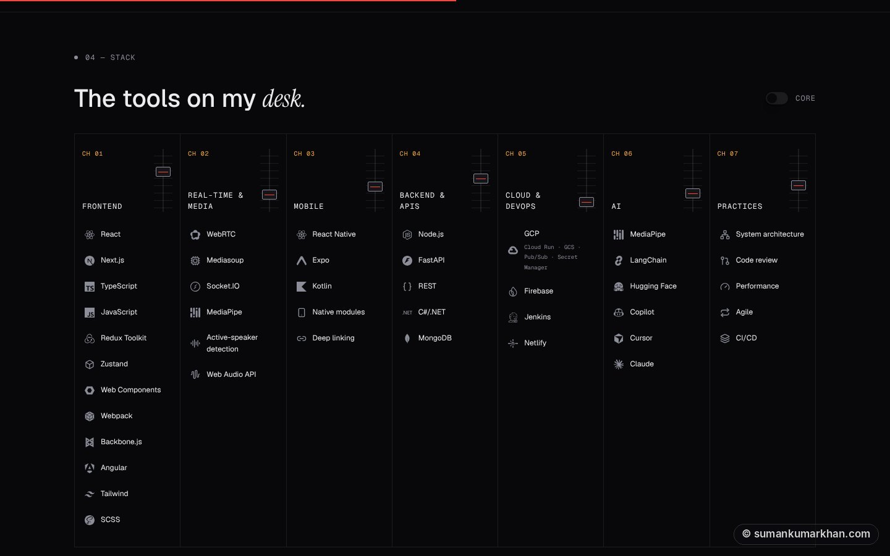

A **Core** toggle trims the board down to the tools I use most.

### Case studies
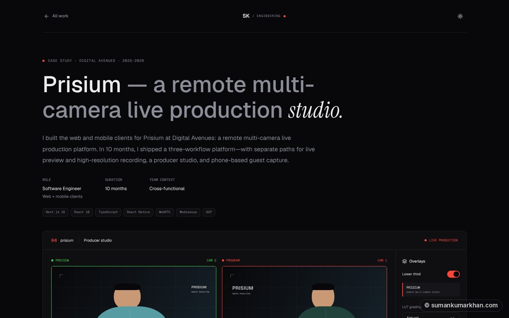

Five dedicated pages (**Prisium, App Studio, HRM, AR/VR, Vehicle Tracking**) with role, duration and team context, numbered figures, an interactive producer-studio demo and a simulated camera-switching walkthrough, results, and previous / next navigation.

### Blog — written in a private editor, published everywhere
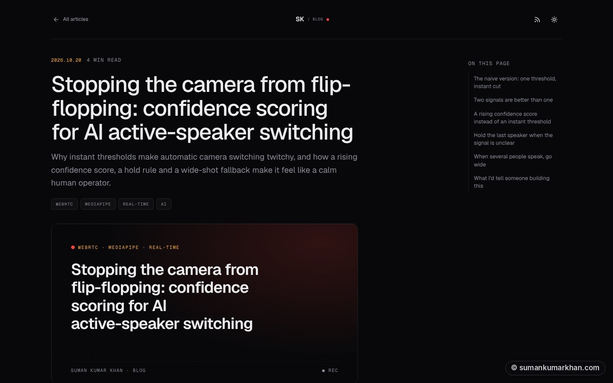

MDX articles with Shiki syntax highlighting, an "On this page" table of contents, reading time, an RSS feed, auto-generated cover images, and a sitemap that updates itself.

### Contact
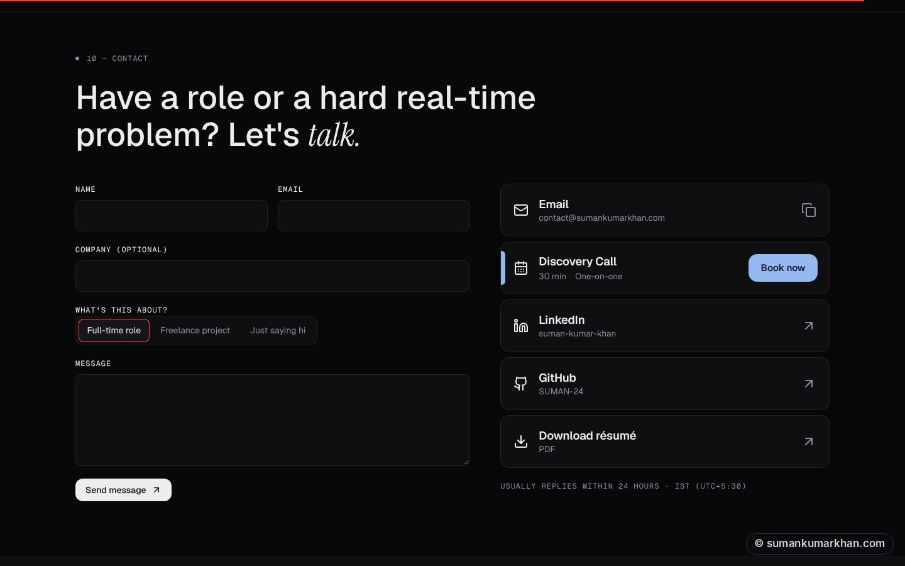

A validated form (name, email, company, topic, message) that emails me directly, with a spam honeypot, plus one-click email copy, Calendly booking, LinkedIn, GitHub and résumé download.

<table>
<tr>
<td width="62%" valign="top">

### ⌘K command palette
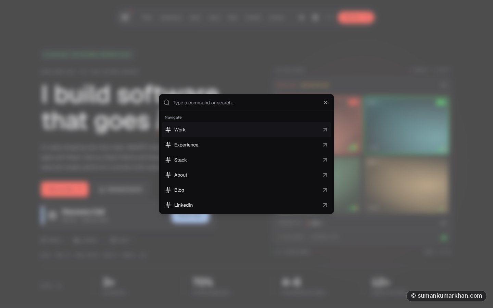

Jump to any section, case study, the blog, LinkedIn posts or the résumé — or **book a call, copy my email, download the résumé and switch theme** — without touching the mouse. Recently used commands float to the top.

</td>
<td width="38%" valign="top">

### 📱 Fully responsive
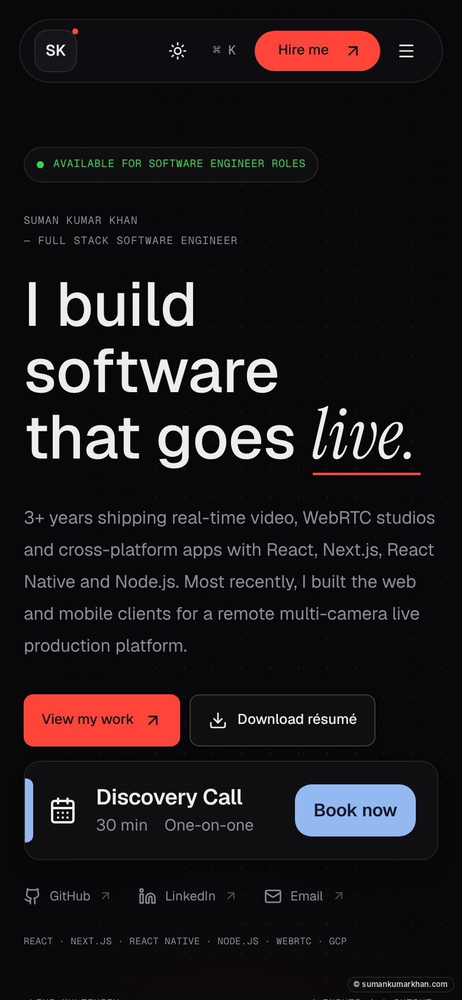

</td>
</tr>
</table>

### And the small things
- 📄 **Printable résumé page** (`/resume`) alongside the PDF download
- 💬 **"From LinkedIn"** — short posts with images or video, on their own page and previewed on the home page
- ⭐ **LinkedIn recommendations** section
- 👋 A polite **exit-intent prompt** to book a call — mouse users only, only after 10 seconds on the page, and silent for 14 days once seen
- 🕒 A live **IST clock** in the footer, so visitors know when I'm likely to reply
- 🍪 **Anonymous, cookie-free analytics** — no tracking across sites and no cookie banner to dismiss

---

## 🎚️ Behind the scenes: the private studio

The site has a private back office at `/admin`, protected by Cloudflare Access. It has **four sections, each with its own bookmarkable address**, and opening plain `/admin` takes me back to the one I used last.

<table>
<tr>
<td width="25%" valign="top">

### ✍️ Blog posts
`/admin/blog-posts`

Write and edit MDX posts, publish them live in seconds, and share them to LinkedIn and dev.to now or on a schedule.

</td>
<td width="25%" valign="top">

### 💬 LinkedIn posts
`/admin/linkedin-posts`

Short posts with images or video that appear on the site and go to LinkedIn — published on the site only once LinkedIn accepts them.

</td>
<td width="25%" valign="top">

### 📊 Analytics
`/admin/analytics`

The site's own traffic report, so I never need to open the Cloudflare dashboard just to look.

</td>
<td width="25%" valign="top">

### 📚 Handbooks
`/admin/handbooks`

A private reading room for my AI-filmmaking study handbooks, read one module at a time.

</td>
</tr>
</table>

**Publishing status at a glance.** Every post card shows a chip for each destination — **site, dev.to and LinkedIn** — marked *posted*, *scheduled*, *in progress* or *failed*. Cards refresh on their own while anything is still pending, and posts are sorted by the date that matters for their state.

**A full analytics dashboard**, mirroring Cloudflare's own:

| Card | What it shows when opened |
| --- | --- |
| **Page views** and **Visits** | A trend, plus breakdowns by page, host, referrer, country, browser, operating system and device |
| **Core Web Vitals** (LCP, INP, CLS) | P50, P75, P90 and P99 for each, a trend, and breakdowns by page, browser, OS and country |
| **Page load time** | The median now versus the period before, with the same percentiles, trend and breakdowns |

- **Time ranges** from the last 30 minutes to 90 days, or an exact start and end date — charts switch between minute, hour and day buckets to suit
- With no card open: a page-views chart and the top pages, referrers, countries, devices, browsers and systems
- Figures follow Cloudflare's defaults — bots excluded, days cut in my own time zone, and change measured against the same length of time before — so the two always agree

**A private handbook library.** Handbooks are added straight from the studio — paste JSON or upload a file — with no code change and no deploy:

- **Content is data, never code.** Each handbook is plain JSON made of modules and typed blocks — intros, lists, steps, tables, prompts with copy buttons, tips, stats, charts and resource links
- **Checked as you type**: one validator reports the exact place of every problem, and refuses unknown fields, broken tables and over-long text
- **A reader built for study**: one module at a time with a numbered progress strip, and progress remembered in the browser only
- **Manage the library**: add, replace, download as JSON for backup, delete, or restore a built-in original
- **The private text never enters the code repository** — handbooks are stored in Cloudflare KV, and the files waiting to be added sit in a folder Git ignores

---

## 🏗️ Architecture

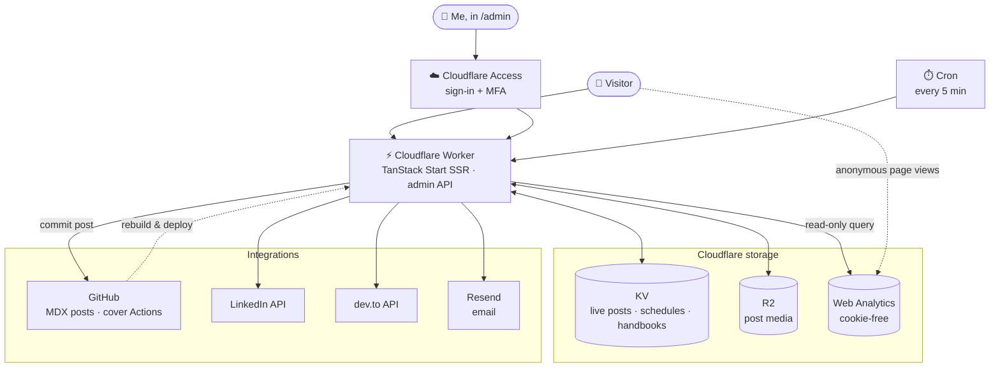

The whole site is **server-rendered on Cloudflare's edge**. Everything a visitor sees — career facts, projects, stack, case studies — lives in **typed content files**, so updating the portfolio means editing data, not markup.

### How publishing a blog post works

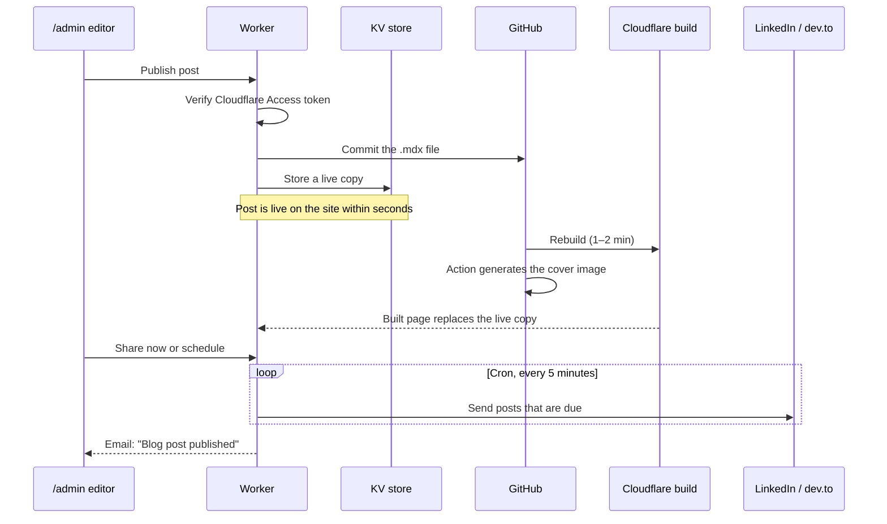

### How a handbook is saved and read

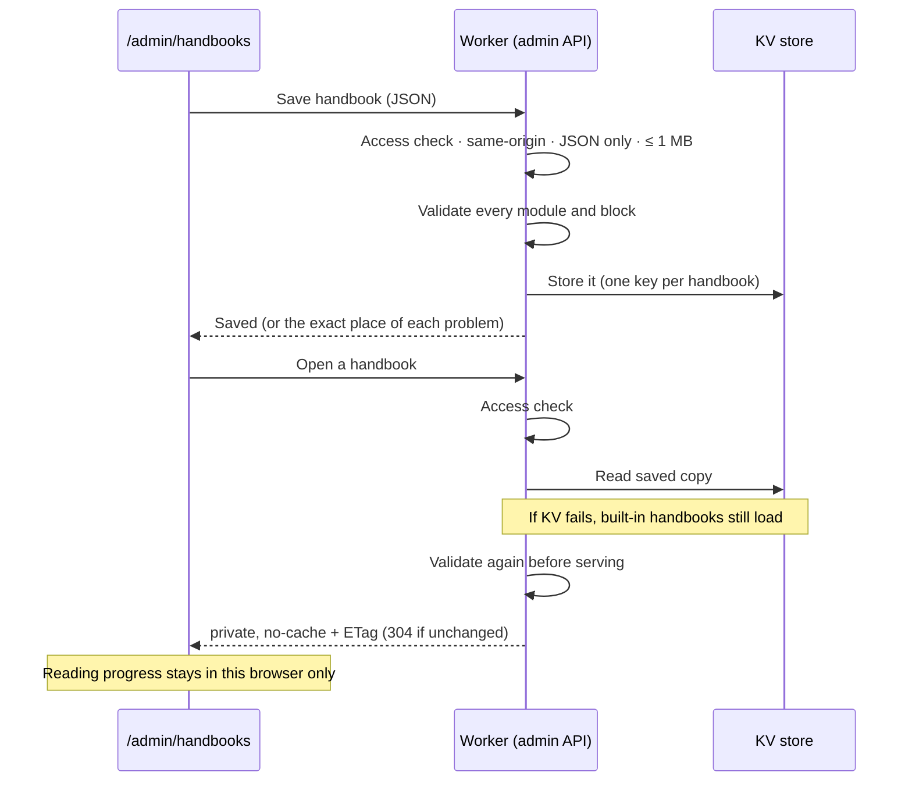

---

## 🧠 Key engineering decisions

| Decision | Why |
| --- | --- |
| **TanStack Start on Cloudflare Workers** | Server-rendered, type-safe routing with each page owning its own metadata — fast first paint and clean link previews, served from the edge |
| **Typed content, not hard-coded markup** | Career facts, projects and stack live in TypeScript files, so claims are auditable, consistent across pages and covered by tests |
| **Blog posts as MDX files in Git** | Posts stay reviewable files with full history; the editor simply commits them, so the existing build, cover and cross-post pipelines run unchanged |
| **Instant publish via KV, build takes over** | A new post is live in seconds instead of waiting for a rebuild; once a newer build is running, the built page wins and the stored copy is ignored |
| **Safe Markdown renderer for live copies** | Workers don't allow `eval`, which MDX needs, so live copies are drawn by a small renderer that never runs code |
| **Own scheduling queue + 5-minute cron** | LinkedIn and dev.to can't schedule posts through their APIs, so the schedule lives in KV and a cron job sends whatever is due |
| **Never post twice, never post a dead link** | Sends are idempotent: an interrupted send is marked failed rather than retried blindly, a post waits until it's live on the site, and an article already on dev.to is reused, not duplicated |
| **Email failures never block publishing** | Notifications are sent only after a post is saved, and a failed email can't change or hide it |
| **Cookie-free analytics, counted only where it means something** | Cloudflare Web Analytics sets no cookies and doesn't follow people across sites, so there's no consent banner. It loads only on the live site, never in `/admin`, and any browser can opt out — so my own visits don't skew the numbers |
| **Analytics read on the server, one measure at a time** | The Worker queries Cloudflare's analytics API itself, so the dashboard lives in my own studio. Each extra measure (Core Web Vitals, page load time) is a separate request, so one failing metric never hides the main numbers |
| **Handbooks as validated JSON, stored outside the code** | New handbooks need no code change or deploy, and their private text never lands in the repository. The same validator checks a handbook on the way in *and* on the way out, and if KV ever fails, the built-in handbooks still load |
| **Pure, browser-safe helpers** | The camera-switching simulation, timecode and exit-intent logic are plain functions, so they're easy to test without a browser or media streams |

## 🔐 Security & privacy

- **The admin editor is private twice over**: Cloudflare Access blocks everyone else before the page loads, and the server re-verifies Access's **signed token (RS256, audience-checked)** on every request. If any setting is missing, it **refuses everyone**.
- **Server-only code is kept out of the browser bundle** by the build, so secrets can't leak to the client.
- **Least-privilege GitHub token** — it can only write to this one repository.
- **No silent overwrites** — saving a post is refused if it changed on GitHub since it was opened.
- **Contact form**: schema validation on client *and* server, length limits, a request-size cap and a honeypot field against bots.
- **Uploads are checked by their real file signature**, not just the extension, with size limits per type.
- **Analytics access is read-only and stays on the server**: the Cloudflare token can only read analytics, never reaches the browser, sits behind the same Access check, and every query is built only from validated values.
- **Handbook text never reaches the page source or the browser bundle** — only the Worker reads it, after the Access check, and refuses everyone if that check isn't configured. Saving requires a same-origin JSON request, every handbook is capped at 1 MB, and responses are `private, no-cache` with ETags.
- **Safe links only** — resource links must be full `https://` addresses (`javascript:`, `data:`, relative links and embedded passwords are refused when saving) and open in a new tab with `noopener noreferrer`.
- **The studio stays out of search engines and analytics** — every `/admin` page is marked `noindex, nofollow` and never loads the analytics script.
- **Privacy by default**: visitor analytics are anonymous and cookie-free, never load in the private studio, and can be switched off per browser.

## ✅ Quality

- **390+ automated tests** with Vitest and Testing Library — routing, content, contact form and email, the admin API and its sign-in check, scheduling, cross-posting and publishing status, analytics reports and date ranges, handbook validation, storage and API, cover images, the case-study simulations and more
- **ESLint + Prettier** across the codebase, and TypeScript end to end
- **Accessibility**: keyboard-first command palette, focus-managed dialogs, and animations that respect `prefers-reduced-motion`
- **SEO and sharing**: per-page titles, descriptions, canonical URLs and Open Graph / Twitter cards, plus RSS and an automatically updated sitemap

---

## 🛠️ Built with

| Area | Tools |
| --- | --- |
| **Framework** | TanStack Start, TanStack Router, React 19, TypeScript |
| **Styling & motion** | Tailwind CSS 4, Radix UI primitives, Framer Motion, Geist & Instrument Serif |
| **Content** | MDX, remark / rehype, Shiki, typed TypeScript content, schema-validated JSON handbooks |
| **Hosting & data** | Cloudflare Workers, KV, R2, Access, Cron Triggers (via Nitro) |
| **Analytics** | Cloudflare Web Analytics, Cloudflare GraphQL Analytics API |
| **Integrations** | Resend (email), LinkedIn API, dev.to API, GitHub API, Calendly |
| **Tooling** | Vite 8, Bun, Vitest, Testing Library, ESLint, Prettier, GitHub Actions |

---

### Like what you see?

**[Visit the site](https://sumankumarkhan.com)** · **[Book a 30-min call](https://calendly.com/sumankumarkhan/30min)** · **[LinkedIn](https://www.linkedin.com/in/suman-kumar-khan/)** · **[contact@sumankumarkhan.com](mailto:contact@sumankumarkhan.com)**

🔒 The source code stays private. I'm happy to walk through it once I've been hired and onboarded.

